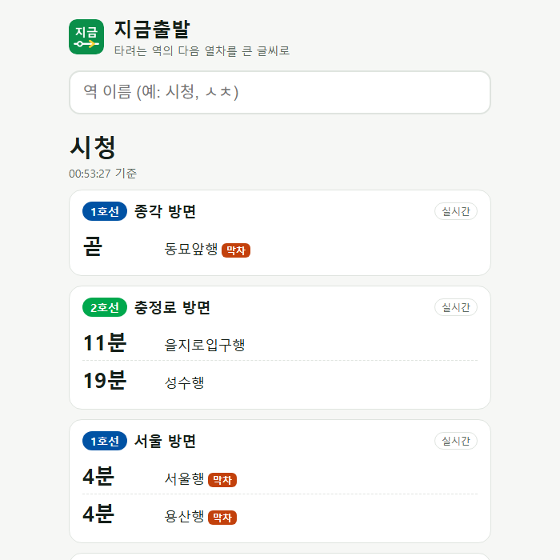
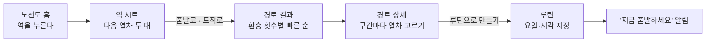
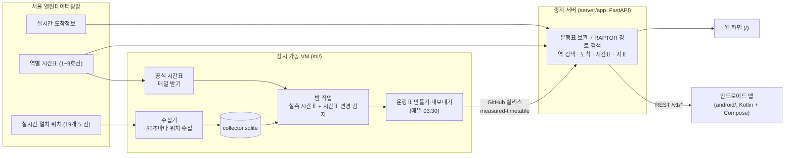
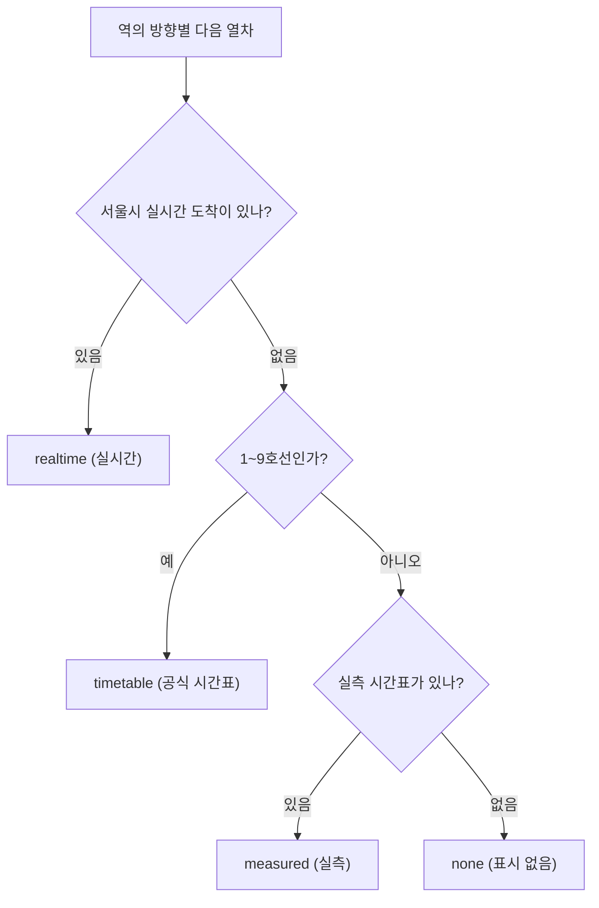
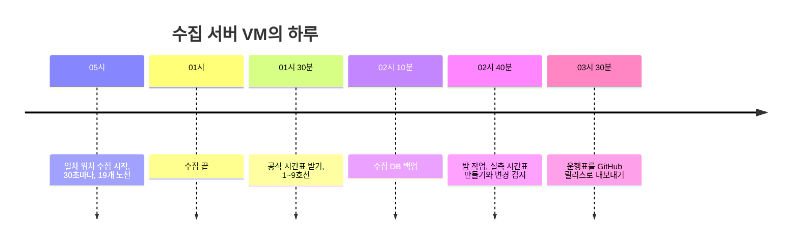
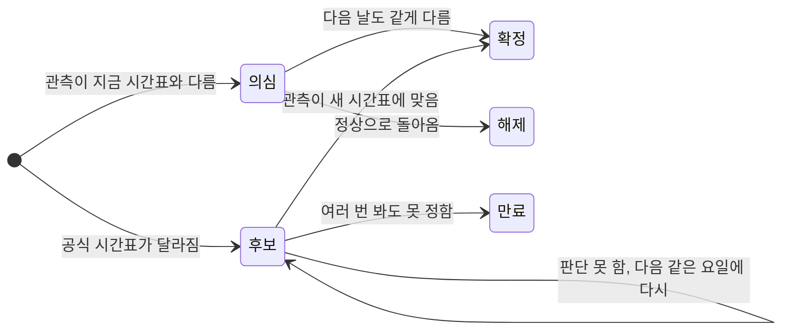
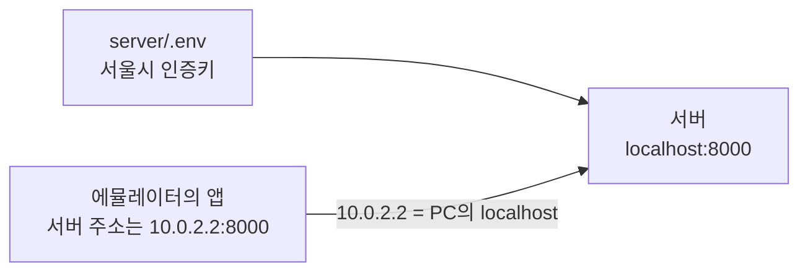

# 지금출발


**"지금 출발하면 어느 열차를 탈 수 있지?"에 바로 답하는 서울 지하철 앱.**

> 저장소 이름은 `subway_easy`, 앱 이름은 지금출발(가칭)이다. 서울시·서울교통공사와 무관한 비공식 프로젝트이고, 서울 열린데이터광장의 공개 데이터를 쓴다.

<p align="center">
  
</p>

## 이게 뭔가요? (처음 보시는 분께)

출근길에 지하철 앱을 열면 정보가 너무 많아서, 정작 필요한 "내가 탈 열차가 몇 분 뒤에 오는지"를 찾기 어렵습니다. 지금출발은 그것만 크게 보여 줍니다.

- **역을 고르면 다음 열차를 큰 글씨로.** 호선·방향별로 다음 열차 두 대가 몇 분 뒤에 오는지, 어디행인지, 막차·급행인지 보여 줍니다. 역 이름이나 초성(`ㅅㅊ` → 시청)으로 찾습니다.
- **가는 길 찾기.** 출발역과 도착역(원하면 경유역)을 고르면, 실제 열차 시각표를 따라 가장 빨리 도착하는 경로를 환승 횟수별로 보여 줍니다. 구간마다 앞뒤 열차나 급행·일반을 골라 볼 수도 있습니다.
- **매일 타는 길은 루틴으로.** 요일과 시각을 정해 두면 그 시각부터 열차를 지켜보다가 "지금 출발하세요"라고 알려 줍니다. 놓치면 놓쳤다고 알려 줍니다.
- **노선도에서 바로 고르기.** 앱을 열면 확대·이동되는 노선도가 보이고, 역을 눌러 열차를 확인합니다.

앱 안에서는 이렇게 이어집니다.



### 직접 써 보기

- **웹 화면(설치 불필요):** <https://jigeumchulbal-server.onrender.com/> — 역 이름을 검색하면 다음 열차가 나옵니다. 예: [시청역](https://jigeumchulbal-server.onrender.com/?station=시청)
  - 무료 서버라서 한동안 아무도 안 들어오면 잠이 듭니다. 첫 화면이 뜨기까지 30~60초 걸릴 수 있습니다.
- **안드로이드 앱:** 아직 스토어에 올라 있지 않고, 이 저장소에도 설치 파일(APK)은 없습니다. 소스에서 직접 빌드해 설치합니다([실행해 보기](#실행해-보기)).

### 알아 둘 점

노선마다 쓸 수 있는 데이터가 달라서, 기능이 닿는 범위도 다릅니다.

| 노선 | 실시간 도착 | 공식 시간표 | 열차 위치 수집(실측) | 경로 검색 |
|---|:---:|:---:|:---:|:---:|
| 1~9호선 | ✅ | ✅ | ✅ | ✅ |
| 경의중앙선, 공항철도, 경춘선, 수인분당선, 신분당선, 우이신설선, 서해선, 경강선, 신림선, GTX-A | ✅ | ❌ | ✅ | ✅ |
| 인천 1·2호선, 에버라인, 의정부경전철, 김포골드라인 | ❌ | ❌ | ❌ | ❌ |

공식 시간표가 없는 노선은 직접 모은 실측 시간표로 채우고, 실시간이 비는 방향도 시간표나 실측으로 채웁니다.

- 열차 시각은 서울시 공개 데이터와 직접 모은 운행 기록으로 만든 **참고용**입니다. 실제 운행과 다를 수 있습니다.
- 인천 1·2호선, 에버라인, 의정부경전철, 김포골드라인은 서울시가 실시간 정보를 주지 않아 "실시간 정보를 제공하지 않는 노선"으로 표시하고, 경로 검색에서도 뺍니다.
- 로그인이 없고, 루틴·자주 가는 경로·알림 상태는 휴대폰에만 저장됩니다. 서버가 모으는 것은 열차 위치 같은 공개 운행 데이터이고, 서버 접근 로그에는 요청 주소의 좌표 같은 쿼리를 남기지 않습니다.

---

## 개발자를 위한 소개

### 한 줄 요약

서울시 실시간 도착 API와 시간표 API가 못 주는 것(미래 열차, 시간표가 없는 노선, 열차 단위 경로)을, **열차 위치를 직접 수집해 만든 실측 시간표**와 **자체 RAPTOR 경로 검색**으로 채운 안드로이드 앱 + 중계 서버 + 데이터 수집 파이프라인.

### 구성



| 부분 | 위치 | 하는 일 |
|---|---|---|
| 안드로이드 앱 | `android/` | 노선도 홈, 역 시트, 검색, 경로·열차 고르기, 루틴, 승차·하차 알림. Kotlin, Jetpack Compose, minSdk 26 |
| 중계 서버 | `server/app/` | 외부 API를 한곳에서 받아 앱에 맞게 가공. 캐시, 호출 한도 보호, 요청 제한, 경로 검색. Python 3.12, FastAPI |
| 수집·분석 파이프라인 | `server/ml/` | 열차 위치를 모아 실측 시간표를 만들고, 공식 시간표가 바뀌었는지 판단하고, 서버가 쓸 운행표를 내보냄. VM에서 systemd 타이머로 돔 |
| 문서 | `docs/` | 설계 스펙, 구현 계획, 학습 노트, 측정 결과 |

### 기술적으로 볼 만한 것

- **자체 경로 검색(RAPTOR).** 길찾기 API를 쓰지 않고 운행표로 직접 계산합니다. 환승 횟수마다 가장 빠른 경로를 최대 5개 내며(파레토), 급행이 서지 않는 역에서는 내리지 않습니다. 순수 모듈이라 외부 호출이 없습니다. → `server/app/services/raptor.py`, `docs/superpowers/specs/2026-11-18-own-routing-design.md`
- **실측 시간표.** 공식 시간표가 없는 노선은 위치 API의 도착·출발 이벤트를 모아 (요일 구분, 호선, 방향, 역)별 출발 시각표를 만듭니다. 열차 번호가 날마다 같은 노선은 번호로, 아닌 노선은 시각으로 묶습니다. 서서 가는 급행과 서지 않고 지나가는 급행도 가려냅니다. → `server/ml/b1.py`, `docs/ml/`
- **시간표 변경 감지.** 새 열차가 생기거나 시각이 바뀐 것을 관측으로 감지합니다. 1~9호선은 공식 시간표를 매일 받아 달라진 단위를 후보로 두고, 그날 관측이 옛·새 시간표 가운데 어느 쪽에 맞는지 표를 세어 확정합니다. → `server/ml/changes.py`, `server/ml/official.py`, `docs/ml/timetable-changes.md`
- **데이터 출처 폴백.** 한 방향이 실시간이 없으면 공식 시간표로, 그것도 없으면 실측 시간표로 채우고 응답에 출처(`realtime`·`timetable`·`measured`)를 표시합니다.
- **외부 API 예절.** 일일 호출 한도 보호(`QuotaGuard`), TTL 캐시, 요청 제한, 키를 가린 로그. → `server/app/cache/`, `server/app/clients/http.py`
- **작게 나눈 기록.** 구현 작업마다 설계 → 계획 → 테스트 먼저(TDD) → 학습 노트 순으로 남깁니다. → `docs/superpowers/`, `docs/learning/`

**다음 열차를 어디서 채우나** — 방향마다, 앞 단계에 없을 때만 다음 단계로 넘어갑니다. 응답의 `source`가 어느 단계였는지 알려 줍니다.



**VM의 하루** — 수집기가 05:00부터 다음 날 01:00까지 돌고, 그 뒤 새벽에 정리 작업이 차례로 돕니다(KST, systemd 타이머).



**시간표가 바뀌었다는 걸 어떻게 확정하나** — 한 번 이상해 보인 것만으로는 바꾸지 않고, 다른 날 관측으로 다시 확인합니다. 하루짜리 사고·지연은 "해제"로 걸러집니다.



### 서버 API

| 메서드·경로 | 설명 |
|---|---|
| `GET /health` | 상태 확인 |
| `GET /v1/stations/search` | 역 검색(이름·초성) |
| `GET /v1/stations/nearest` | 좌표에서 가장 가까운 역 |
| `GET /v1/stations/{id}/arrivals` | 방향별 다음 열차(실시간, 없으면 시간표·실측으로 대체) |
| `GET /v1/stations/{id}/timetable` | 역 시간표(시각 지정 가능) |
| `GET /v1/routes` | 역 → (경유역) → 역 경로, 구간마다 후보 열차 포함. 운행표를 받기 전에는 503 |
| `GET /v1/metrics` | 지표. `METRICS_TOKEN`을 정해 두고 `X-Metrics-Token` 헤더를 보내야 보임(아니면 404) |

자세한 요청·응답 형식은 서버를 띄운 뒤 `/docs`(FastAPI 자동 문서)나 [설계 스펙](docs/superpowers/specs/2026-11-02-jigeumchulbal-mvp-design.md)을 봅니다.

### 실행해 보기

**서버**(Python 3.12 이상)

```bash
cd server
python -m venv .venv
.venv/Scripts/python -m pip install -e ".[dev]"   # macOS·Linux는 .venv/bin/python
cp .env.example .env                              # 키를 채운다(아래)
.venv/Scripts/python -m pytest -q                 # 테스트: 키 없이 돈다(기록한 응답 사용)
.venv/Scripts/python -m uvicorn app.main:app --reload
```

- `SEOUL_REALTIME_API_KEY`(실시간 도착)와 `SEOUL_OPENAPI_KEY`(시간표, 일반 인증키)는 [서울 열린데이터광장](https://data.seoul.go.kr)에서 발급합니다. 키 값은 저장소에 넣지 않습니다(`server/.env`는 커밋 대상이 아닙니다).
- 경로 검색은 서버가 GitHub 릴리스 `measured-timetable`에서 운행표를 받아 둔 뒤에 됩니다(기본 주소는 이 저장소의 릴리스, `MEASURED_BASE_URL`로 바꿈, 비우면 실측을 쓰지 않음).

서버를 띄우면 `http://localhost:8000`에서 열립니다. 에뮬레이터 안의 앱은 PC의 `localhost`를 `10.0.2.2`로 부르므로, `local.properties`의 `server.baseUrl`은 `http://10.0.2.2:8000/`로 둡니다.



**안드로이드 앱**(Android Studio 또는 JDK + Android SDK)

```bash
cd android
cp local.properties.example local.properties   # server.baseUrl을 서버 주소로 (에뮬레이터에서 PC의 서버는 http://10.0.2.2:8000/)
./gradlew testDebugUnitTest assembleDebug
```

**수집 파이프라인**(`server/ml/`)은 VM에 올려 돌리는 용도입니다. 설치와 운영은 [수집기 안내](docs/ml/collector.md)와 [시간표 변경 감지 안내](docs/ml/timetable-changes.md)를 봅니다. 이 부분은 일반 인증키 말고도 위치 API 키가 따로 필요합니다.

## 저장소 구조

```
subway_easy/
├─ android/                 안드로이드 앱 (Kotlin, Jetpack Compose)
├─ server/
│  ├─ app/                  중계 서버 (Python, FastAPI)
│  ├─ ml/                   열차 위치 수집, 실측 시간표, 변경 감지 (VM에서 실행)
│  ├─ scripts/              역 데이터·노선도 만드는 일회성 스크립트
│  ├─ data/                 역 기준 데이터(stations.sqlite), 노선도 원본
│  └─ tests/                서버·수집 파이프라인 테스트
├─ docs/
│  ├─ superpowers/specs/    설계 스펙
│  ├─ superpowers/plans/    구현 계획
│  ├─ ml/                   수집기·시간표 변경 감지 운영 안내, 예측 설계
│  ├─ analysis/             원본 앱 분석, 외부 API 확인 결과
│  ├─ measurements/         UX 비교, 실기기 점검표
│  ├─ gallery/              서울 열린데이터광장 활용 사례 신청 자료
│  └─ learning/             학습 노트
├─ .github/
│  ├─ workflows/            CI (server.yml, android.yml)
│  └─ ISSUE_TEMPLATE/       버그 템플릿
└─ render.yaml              서버 배포 설정(Render)
```

## 문서

| 궁금한 것 | 볼 문서 |
|---|---|
| 무엇을 왜 만드나(처음 설계) | [1차(MVP) 설계 스펙](docs/superpowers/specs/2026-11-02-jigeumchulbal-mvp-design.md), [간단한 지하철 앱으로 다시 설계](docs/superpowers/specs/2026-11-12-simple-subway-redesign.md) |
| 경로는 어떻게 계산하나 | [경로 직접 계산 설계](docs/superpowers/specs/2026-11-18-own-routing-design.md), [열차 고르기 설계](docs/superpowers/specs/2026-11-18-train-picker-design.md) |
| 실측 시간표는 어떻게 만들고 앱에 오나 | [열차 도착 예측·수집 설계](docs/ml/2026-11-13-train-eta-model-plan.md), [실측 시간표 연결 설계](docs/superpowers/specs/2026-11-17-measured-timetable-serving-design.md), [수집기 운영](docs/ml/collector.md), [시간표 변경 감지 운영](docs/ml/timetable-changes.md) |
| 외부 API는 실제로 어떻게 응답하나 | [외부 API 확인 결과](docs/analysis/api-verification.md), [원본 앱 분석](docs/analysis/original-app.md) |
| 어떤 순서로 만들었나 | [구현 계획 목록](docs/superpowers/plans/README.md), [학습 노트](docs/learning/README.md) |
| 써 보니 어땠나 | [원본 대비 UX 측정](docs/measurements/ux-comparison.md) |

## 데이터 출처

| 데이터 | 출처 | 쓰는 곳 |
|---|---|---|
| 실시간 도착정보 | 서울 열린데이터광장 | 역 화면의 "다음 열차" |
| 역별 시간표(1~9호선) | 서울 열린데이터광장 | 시간표 대체, 경로 운행표, 변경 감지 |
| 실시간 열차 위치정보 | 서울 열린데이터광장 | 실측 시간표 만들기(수집기) |
| 역사마스터, 지하철역 정보 | 서울 열린데이터광장 | 역 기준 데이터(`stations.sqlite`) |
| 실측 시간표·구간 시간 | 위치 수집으로 직접 만듦 | 시간표가 없는 노선, 경로 계산 |
| 노선도 | 직접 그린 "수도권 철도 노선도 아틀라스 에디션"(`server/data/raw/linemap_atlas.svg`) | 앱 홈 화면. `server/scripts/build_linemap.py`가 역 위치표를 만든다 |

## 라이선스

아직 라이선스 파일이 없습니다. 코드를 재사용하려면 먼저 저장소 주인에게 문의해 주세요.

<details>
<summary>배포·운영 메모 (서버를 직접 운영하는 사람용)</summary>

- 서버: https://jigeumchulbal-server.onrender.com (Render 무료 요금제, `render.yaml` 블루프린트, `develop` 브랜치, 2026-11-12). 공개 저장소 주소로 연결해 자동 배포는 꺼져 있다. 새 커밋은 Render 대시보드의 [Manual Deploy]로 올린다.
- 키 2개(`SEOUL_REALTIME_API_KEY`, `SEOUL_OPENAPI_KEY`)는 대시보드 환경 변수에만 있다. 카카오 키는 경로를 직접 계산하면서(2026-11-18) 쓰지 않는다.
- 경로: VM이 매일 03:30에 올리는 열차 운행표(릴리스 `measured-timetable`의 `trips-…`)로 서버가 RAPTOR 검색을 한다. 운행표를 받기 전에는 경로 요청이 503("경로 정보를 준비 중이에요")이다.
- 열차 고르기: 경로 응답의 지하철 단계마다 후보 열차(고른 열차 30분 전~2시간 뒤, 최대 40대)가 붙는다. 경로 상세에서 구간마다 [이전]/[다음]·급행/일반을 고르면 앱이 바로 다시 계산한다. 바꾼 구간만 고정하고, 뒤 구간은 앞 열차가 내린 뒤 탈 수 있는 첫 열차로 맞추며, 고정한 구간끼리 어긋나면 경고한다. [지금 출발 알림]은 고른 첫 열차에 맞추고, 놓치면 "고른 열차를 놓쳤어요"로 끝난다. 루틴은 고른 열차를 저장하지 않는다.
- 실측 시간표: 서버는 `MEASURED_BASE_URL`(기본: 이 저장소 릴리스 `measured-timetable`)에서 VM 결과물을 6시간마다 받는다. 비우면 실측을 쓰지 않는다(2026-11-18).
- 지표(`/v1/metrics`)는 대시보드 환경 변수 `METRICS_TOKEN`을 정해 두고, 같은 값을 `X-Metrics-Token` 헤더로 보내야 보인다. 정하지 않으면 404다(2026-11-17).
- 2026-11-12 배포 직후 확인: `/health`, 역 검색, 영등포구청 실시간 도착, 마포→공덕 경로, 영등포구청 5호선 시간표 모두 정상.
- 앱은 `android/local.properties`의 `server.baseUrl`을 이 주소로 둔다. 무료 서버는 쉬다가 깨어나는 데 1분 가까이 걸린다.

</details>
